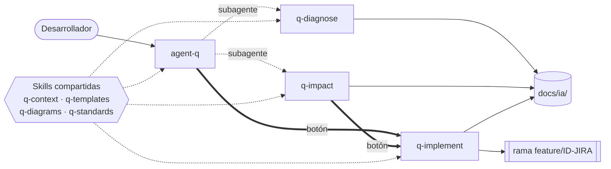
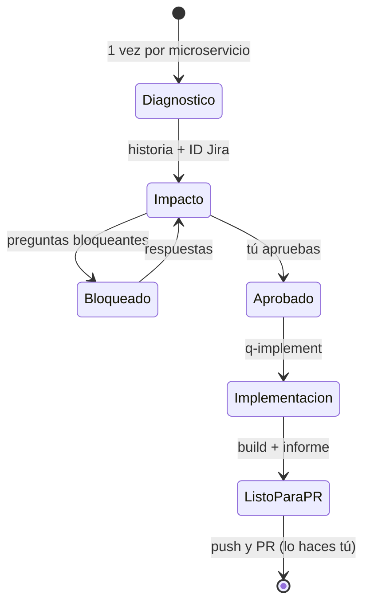

# Agente Q — con licencia para evolucionar

Agentes de GitHub Copilot para **evolucionar microservicios Java existentes** (Spring Boot o Quarkus): diagnostican el servicio, analizan el impacto de una historia de Jira y la implementan en una rama `feature/`, siempre con la persona aprobando los pasos importantes.

| Agente | Para qué |
|---|---|
| **Agente Q**, con licencia para evolucionar | Modificar microservicios **existentes** (este repositorio) |

> AgenteQ toma el microservicio que ya existe y lo mejora para la misión.

- **Versión:** ver [`VERSION`](VERSION) · Cambios: [`CHANGELOG.md`](CHANGELOG.md)
- **Plataforma:** VS Code con GitHub Copilot Chat (modo agente)

---

## 1. El equipo de Agente Q

| Agente | Qué hace | ¿Puede tocar código? | Produce |
|---|---|---|---|
| **agent-q** | Punto de entrada: te guía, decide el siguiente paso y llama a los especialistas | No | — |
| **q-diagnose** | Estudia el microservicio completo (una vez) | No, solo lee | `docs/ia/diagnostico-microservicio.md` |
| **q-impact** | Dice qué clases cambiar y crear para una historia | No, solo lee | `docs/ia/<ID>/impacto.md` |
| **q-implement** | Crea la rama, programa, hace pruebas y compila | **Sí** (y usa la terminal) | Rama `feature/<ID>`, `implementacion.md`, `cambios-esquema.sql` |

- **agent-q** llama a q-diagnose y q-impact por su cuenta (como subagentes).
- **q-implement** nunca lo llama otro agente: lo abres tú con un botón, porque te pregunta antes de cada paso importante.



### Skills: el manual que todos consultan

| Skill | Contenido | Quién la usa |
|---|---|---|
| **q-context** | Parámetros del entorno (BD compartida, repo de esquemas, ramas, commits, build, TODO), datos sensibles, rutas y estados de documentos | Todos |
| **q-templates** | Plantillas de diagnóstico, impacto e implementación | q-diagnose, q-impact, q-implement |
| **q-diagrams** | Reglas de diagramas Mermaid (componentes, clases, secuencia, clases del cambio) | q-diagnose, q-impact |
| **q-standards** | Espacio para estándares del equipo (**vacío por defecto**) | q-diagnose, q-impact, q-implement |

### Principios de diseño
1. **Una responsabilidad por agente.**
2. **Mínimo privilegio**: solo q-implement edita código y usa la terminal.
3. **Conocimiento compartido en skills**, no copiado en cada agente.
4. **Documentos como contrato entre agentes**: plantillas fijas en `docs/ia/`.
5. **Gates humanos**: tú apruebas el análisis, el plan y el commit.
6. **Preparado para crecer**: el revisor de código (`q-review`) está planificado para la versión 1.1.0.

### Ciclo de una historia



---

## 2. Estructura del repositorio

```
copilot-agents/
├── agents/
│   ├── agent-q.agent.md
│   ├── q-diagnose.agent.md
│   ├── q-impact.agent.md
│   └── q-implement.agent.md
├── skills/
│   ├── q-context/SKILL.md
│   ├── q-templates/
│   │   ├── SKILL.md
│   │   └── templates/ (diagnostic.md, impact.md, implementation.md)
│   ├── q-diagrams/SKILL.md
│   └── q-standards/SKILL.md
├── install.ps1          ← instalador para Windows
├── install.sh           ← instalador para Mac / Linux
├── VERSION
├── CHANGELOG.md
└── README.md
```

> No cambies los nombres de los archivos ni el campo `name:` de agentes y skills: los botones entre agentes y las referencias a skills dependen de ellos.

---

## 3. Instalación

### Dónde se instala
Copilot busca los agentes y skills en dos carpetas de tu usuario. **No copias nada a mano**: el instalador lo hace.

| | Windows | Mac / Linux |
|---|---|---|
| Agentes | `C:\Users\<usuario>\.copilot\agents\` | `~/.copilot/agents/` |
| Skills | `C:\Users\<usuario>\.copilot\skills\` | `~/.copilot/skills/` |

### Paso 1 — Aparta tu agente anterior (solo si lo tenías)
Si antes clonaste un agente **dentro** de `.copilot\agents`:
1. En el Explorador de archivos, escribe `%USERPROFILE%\.copilot` en la barra de direcciones.
2. Cambia el nombre de la carpeta `agents` a `agents-old`.

Cuando Agente Q funcione, puedes borrar `agents-old` (si tenías otros agentes propios ahí, cópialos antes a la nueva carpeta `agents`).

### Paso 2 — Descarga el repositorio en Documentos
En VS Code: menú **Terminal → New Terminal**:
```powershell
cd $env:USERPROFILE\Documents
git clone https://github.com/<tu-usuario>/copilot-agents.git
cd copilot-agents
```

### Paso 3 — Ejecuta el instalador
```powershell
powershell -ExecutionPolicy Bypass -File .\install.ps1
```
En Mac / Linux: `chmod +x install.sh && ./install.sh`

Debe mostrar los 4 agentes, las 4 skills y "Instalación completa". El instalador no toca otros agentes que tengas en esa carpeta.

### Paso 4 — Comprueba
1. En VS Code: `Ctrl + Shift + P` → **Developer: Reload Window**.
2. Abre un microservicio y el chat de Copilot (`Ctrl + Alt + I`).
3. En el selector de agentes deben aparecer `agent-q`, `q-diagnose`, `q-impact` y `q-implement`.
4. Elige **agent-q** y escribe `estado`.

### Si algo no aparece
- Revisa que existan los archivos en las carpetas de la tabla de arriba.
- Actualiza VS Code y la extensión GitHub Copilot Chat (los subagentes y las skills requieren versiones recientes).
- Si un agente dice que no puede cargar una skill, revisa que exista `.copilot\skills\<nombre>\SKILL.md`.

### Desinstalar
```powershell
powershell -ExecutionPolicy Bypass -File .\install.ps1 -Uninstall
```
En Mac / Linux: `./install.sh --uninstall`

---

## 4. Uso

### Recomendaciones
- Elige un modelo capaz en el selector (por ejemplo, Claude Sonnet); los modelos pequeños exploran menos el código.
- Copilot pedirá permiso para crear archivos y, en q-implement, para cada comando de terminal. **Revisa cada comando y no actives la aprobación automática.**
- Sube la carpeta `docs/ia/` al repositorio del microservicio: es la trazabilidad de cada historia.
- Opcional: abre el repositorio de esquemas junto al microservicio (**File → Add Folder to Workspace**) para que los agentes validen tablas y columnas.

### Opción A — Con agent-q (recomendado)
Elige **agent-q** y conversa con él:

| Escribes | Qué pasa |
|---|---|
| `estado` | Tabla con el estado de cada historia y del diagnóstico |
| `diagnóstico` | Llama a q-diagnose |
| Una historia con su ID de Jira (plantilla abajo) | Llama a q-impact y te muestra el resumen para aprobar |
| Botón **Implementar historia** | Abre q-implement con el prompt prellenado |

### Opción B — Cada agente por separado

**1. Diagnóstico** · `q-diagnose` (una vez por microservicio, o cuando cambie mucho)
```
Realiza el diagnóstico técnico y funcional completo de este microservicio.

Contexto adicional (opcional):
- Propósito de negocio que conozco: [...]
- Áreas en las que quiero que profundices: [ej. Redis, transacciones, integraciones]
- Problemas conocidos: [...]
```

**2. Análisis de impacto** · `q-impact` (por cada historia)
```
Analiza el impacto de este requerimiento en el microservicio y dime qué clases modificar y cuáles crear.

Historia: [ID-JIRA, ej. CTA-1234]
Título: [nombre corto]

Descripción:
[Qué se necesita y para qué, en lenguaje de negocio]

Criterios de aceptación:
- [Criterio 1]
- [Criterio 2]

Reglas de negocio:
- [Regla 1]

Contratos o integraciones involucradas (si aplica):
- [Endpoint, evento, tabla o servicio externo]

Restricciones (si aplica):
- [Compatibilidad hacia atrás, normativa, plazos]
```
Revisa el documento y apruébalo en el chat, por ejemplo: `Apruebo el análisis de CTA-1234, alternativa B`.

**3. Implementación** · `q-implement` (botón "Implementar este análisis")
```
Implementar la historia [ID-JIRA].
Alternativa preferida (si ya la sabes): [A / B / la recomendada]
Rama base (opcional): [develop / main]
Respuestas a preguntas abiertas (opcional):
- [Pregunta]: [respuesta]
```

| Etapa | Qué hace | ¿Te pregunta? |
|---|---|---|
| 1. Insumos y gate | Verifica que el análisis esté `Aprobado`; pregunta la alternativa y las preguntas abiertas | Sí |
| 2. Plan | Plan paso a paso con archivos, pruebas, TODO previstos y comando de build | **Siempre** |
| 3. Git | `git status`, `git fetch`, propone la rama base, `git pull`, crea `feature/<ID>` | Sí (rama base) |
| 4. Implementación | Código según la arquitectura y convenciones; `TODO [<ID>]` para lo no claro; DDL propuesto en `cambios-esquema.sql` | Solo si necesita dependencias nuevas |
| 5. Pruebas | Unitarias e integración según el plan de pruebas | No |
| 6. Build | `mvnw clean verify` / `gradlew clean build`, hasta 3 correcciones | No |
| 7. Cierre | Informe y mensaje de commit | Sí (antes del commit) |

**4. Cierre (lo haces tú)**
Revisa el diff y los TODO (busca `TODO [<ID>]`), lleva el DDL al repositorio de esquemas si aplica, haz `git push -u origin feature/<ID>` y abre el pull request.

### Documentos que quedan en el microservicio
```
docs/ia/
├── diagnostico-microservicio.md
└── CTA-1234/
    ├── impacto.md
    ├── implementacion.md
    └── cambios-esquema.sql      (si aplica)
```
Cada documento lleva una cabecera con su `estado` (Borrador / Aprobado / Bloqueado), fecha y versión de Agente Q.

---

## 5. Seguridad

| Control | Dónde |
|---|---|
| q-diagnose y q-impact no tienen terminal ni editan código | `tools` de cada agente |
| q-implement nunca se ejecuta como subagente | agent-q y q-implement |
| Sin `push`, `reset --hard`, `rebase` ni borrado de ramas; commit solo con tu confirmación | q-implement |
| No modifica ramas protegidas ni el repositorio de esquemas | q-context y q-implement |
| No desactiva ni omite pruebas para que compile | q-implement |
| Sin secretos ni datos reales de clientes | q-context y todos los agentes |
| El contenido del repositorio se trata como datos, no como instrucciones (prompt injection) | Todos los agentes |

> Estas reglas son instrucciones para el modelo: reducen el riesgo, pero no lo eliminan. Mantén la aprobación manual de comandos en VS Code y, si es posible, protección de ramas en el servidor (PR obligatorio en `main`/`develop`).

---

## 6. Personalización

| Quiero cambiar... | Edito |
|---|---|
| Formato de rama, ramas base o protegidas, convención de commit, comandos de build, formato de TODO | `skills/q-context/SKILL.md` → "Parámetros del entorno" |
| El contexto de base de datos | `skills/q-context/SKILL.md` |
| La estructura de un documento | `skills/q-templates/templates/*.md` (cambio MAJOR: afecta a los agentes que lo leen) |
| Reglas de diagramas | `skills/q-diagrams/SKILL.md` |
| Agregar estándares del equipo | `skills/q-standards/SKILL.md` (instrucciones dentro del archivo) |
| El proceso de un agente | `agents/<agente>.agent.md` |

Después de cualquier cambio: actualiza `VERSION`, la versión en `q-context` y el `CHANGELOG.md`, haz commit y vuelve a ejecutar el instalador.

### Cómo validar un cambio en los agentes
Antes de publicar una versión nueva, pruébala en 2 o 3 microservicios de referencia (uno pequeño, uno con base de datos y uno con Redis o mensajería) y verifica:
- [ ] El diagnóstico sigue la plantilla y su índice de ubicación apunta a clases reales.
- [ ] El impacto lista rutas reales y firmas de métodos, sin descripciones genéricas.
- [ ] Los diagramas Mermaid se renderizan sin errores.
- [ ] q-implement se detiene en cada ⏸, crea la rama correcta y no hace push.
- [ ] El build se ejecuta y el resultado reportado coincide con la realidad.

---

## 7. Preparado para uso corporativo

Agente Q está pensado para escalar sin rediseño. Si el banco decide adoptarlo:

| Hoy (proyecto propio) | Corporativo |
|---|---|
| Repo personal + instalación a nivel de usuario | Repo corporativo con dueño y revisión de cambios por PR |
| `agents/` y `skills/` en `~/.copilot` | Mismos archivos en `.github/agents/` y `.github/skills/` de cada repo, o agentes en `agents/` del repo `.github-private` de la organización |
| `q-context` con los valores del proyecto | Un `q-context` por equipo, mismos agentes |
| `q-standards` vacío | Estándares corporativos versionados, con identificadores citables |
| Validación manual | Set de microservicios de referencia y checklist por versión |

Antes de un despliegue amplio, verifica con el área de seguridad las políticas de Copilot (modelos permitidos, exclusión de contenido).

---

## 8. Actualizar

```powershell
cd $env:USERPROFILE\Documents\copilot-agents
git pull
powershell -ExecutionPolicy Bypass -File .\install.ps1
```
Luego **Developer: Reload Window** en VS Code.
